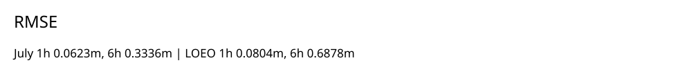
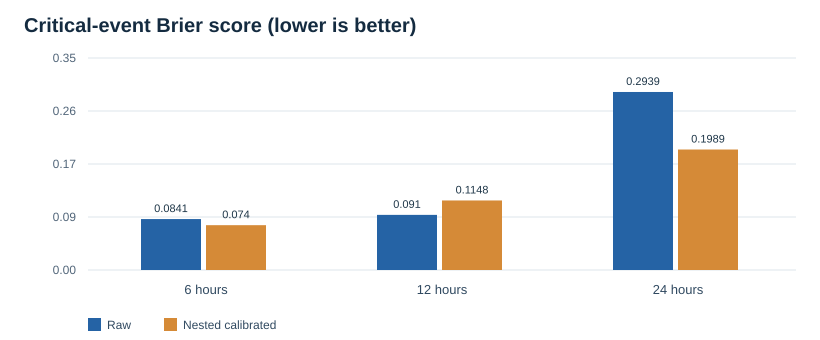

# Chapter 4 — Scientific Validation of GeoAlerta Sul Indicators and Predictive Models

**Draft v1 | 26 October 2026 | Language: English | Case study: Vale do Taquari, Brazil**

**Evidence boundary.** All project-specific numerical results below were transcribed from the private `gilliardleda2018/geoalerta-sul` repository, main branch, as inspected on 26 October 2026. They are **repository-reported retrospective evaluations**, not independently reproduced experiments, prospective forecasts, operational certifications or peer-reviewed findings. This chapter contains no confidential datasets or source code.

## 4.1 Research motivation and validation philosophy

GeoAlerta Sul addresses the engineering and scientific challenge of reconciling heterogeneous hydrological, meteorological, satellite, terrain and territorial-exposure observations for the Vale do Taquari. The contribution under investigation is not the unsupported claim that such information did not previously exist in centralized systems. Instead, the question is whether a provenance-aware integration layer can improve the reliability, interpretability and transferability of evidence-based flood decision support.

The World Meteorological Organization's *Guidelines on the Verification of Hydrological Forecasts* (WMO-No. 1364, 2025) identify accuracy, bias, reliability, resolution and sharpness as complementary aspects of forecast verification [1]. Thus, a single high ROC-AUC or low RMSE is insufficient to establish operational utility. Forecast errors must be interpreted by location, event, horizon and decision threshold.

## 4.2 Indicator registry, availability and admission

The internal indicator registry [P1] reports **189 hydrometeorological candidates**, of which **147 (77.78%)** were available in the documented snapshot and **138 (73.02% of candidates)** were admitted to the trained model. The remaining **51 (26.98%)** were rejected: **46 (24.34%)** for insufficient training coverage and **5 (2.65%)** for being constant during training. Available and admitted are overlapping categories; do not sum their percentages. A separate spatial indicator registry contains **30 indicators per point**, which must not be equated with 30 independently validated predictive features.

Admission does not establish causal importance or out-of-event generalization. Required additional evidence: per-feature availability by station and event, admitted-feature artifact hash, leakage checks, ablation and performance under sensor failure.

## 4.3 River-level prediction: event-wise generalization

The internal model card [P2] reports a hybrid ExtraTrees residual-correction model with a July 2026 temporal holdout RMSE of **0.0623 m at 1 h** and **0.3336 m at 6 h**. The distinct four-event leave-one-event-out assessment [P3] reports **0.0804 m at 1 h** and **0.6878 m at 6 h**. These are *different evaluation designs*, not paired predictions on the same cohort, and therefore should not be interpreted as a direct head-to-head significance test. The higher multi-event error highlights the importance of event-independent validation.

The key threat is temporal autocorrelation within floods: thousands of forecast origins do not equal thousands of independent flood events. A final publication must report errors per held-out event and confidence limits reflecting the small number of independent episodes.

## 4.4 Critical-event probabilities and calibration

The calibrated critical-event model targets the first crossing of the **local Estrela 19 m gauge threshold**, conditioned on the current gauge level being below 19 m [P4]. The nested event-based calibration report [P5] states:

| Horizon | Raw Brier | Nested calibrated Brier | Relative change in Brier | Reported negative-origin false-positive fraction | Status |
|---|---:|---:|---:|---:|---|
| 6 h | 0.0841 | 0.0740 | -12.01% | 0.1511 | Research screening |
| 12 h | 0.0910 | 0.1148 | +26.15% | 0.0630 | Research screening |
| 24 h | 0.2939 | 0.1989 | -32.32% | 0.6455 | Blocked |

Relative change = (calibrated Brier − raw Brier) / raw Brier × 100. **Lower Brier is better.** Calibration worsens the 12 h Brier, while the 24 h result remains unsuitable for operational use despite its lower Brier because the false-positive burden is large. These are repository-reported values; threshold and prevalence dependence must be documented.

## 4.5 Spatial susceptibility: Copernicus EMSR720 holdouts

The repository [P6, P7] describes an experimental comparison with observed flood delineations from Copernicus EMSR720 in three **upstream** areas (Encantado, Roca Sales and Santa Tereza). The dataset includes **2,016 comparison points**, with 504 positives and 1,512 comparison negatives. Non-delineated pixels are not definitive evidence of no inundation.

| Held-out area | Baseline ExtraTrees ROC-AUC | Enriched ExtraTrees ROC-AUC | Delta |
|---|---:|---:|---:|
| Encantado | 0.8491 | 0.8666 | +0.0175 |
| Roca Sales | 0.7657 | 0.7489 | -0.0168 |
| Santa Tereza | 0.9184 | 0.9237 | +0.0053 |
| **Mean** | **0.8444** | **0.8464** | **+0.0020** |

The enrichment fails its own predeclared promotion criterion of **mean ROC-AUC improvement ≥0.02 with no deterioration in any held-out area**. It is therefore **not promoted**. These AOIs do not directly validate Lajeado/Estrela. The official Copernicus EMSR720 activation is publicly described in research literature [2]; redistribution of particular product files remains subject to the provider's terms.

## 4.6 Municipal-stage conformance is not observed-event validation

The Lajeado municipal-stage assessment [P8] compares a static terrain score with **18 simulated municipal flood-stage maps**, using **11,235 sample points**. The reported mean ROC-AUC is **0.8007** (range **0.7709–0.8427**). Because the reference maps are simulated and may share underlying topographic assumptions, this is a *conformance exercise*, not an independent empirical demonstration of real flood extent. The report also flags geometric irregularities at 31 m and 33 m. These should be manually reviewed before reuse as training targets.

## 4.7 Exposure and decision-priority indicators

The exposure layer [P9] combines physical-risk evidence with an exposure multiplier between 1.0 and 1.5, using aggregated IBGE population cells and nearby critical facilities. It is a **rule-based prioritization heuristic**, not a calibrated probability of casualties, damage, inundation or route safety. Missing population and facility observations remain unknown, not zero. Individual or household-level records must not be disclosed.

## 4.8 Source catalogue and lawful reproducibility

| Provider | Evidence family | Public starting point | Important caveat |
|---|---|---|---|
| SGB/SACE | River levels, rain, hydrological bulletins | https://www.sgb.gov.br/sace/ | Local gauge datums and operational authority |
| ANA | Historical river level, rainfall and discharge | https://www.ana.gov.br/hidrowebservice/swagger-ui/index.html | Authentication and source/version qualifiers |
| Defesa Civil RS | Sensor and official operational context | https://redehidrometeorologica.defesacivil.rs.gov.br/Mapa | Some historical access may require permission |
| Copernicus EMS | Observed flood delineation | https://rapidmapping.emergency.copernicus.eu/EMSR720/ | Event/AOI coverage and licensing |
| IBGE | Aggregate population and household grids | https://www.ibge.gov.br/ | Aggregated statistics only |
| CNES | Health facility registry | https://cnes.datasus.gov.br/ | Registry does not prove live service capacity |
| SEDEC/S2ID | Disaster histories and reported impacts | https://s2id.mi.gov.br/paginas/series/ | Post-event outcomes must not leak into predictors |

The URLs are institutional entry points, **not promises of unrestricted dataset redistribution**. The academic repository should publish links, licenses, processing recipes, hashes and non-sensitive derived statistics where permissible; never publish restricted raw data, personal records, AWS secrets or internal storage addresses.

## 4.9 Threats to validity and experimental priorities

**Internal validity:** temporal leakage, feature selection on holdouts, duplicate origins, incompatible rainfall accumulation periods, mixed gauge datums and improperly handled missingness.

**External validity:** limited flood-event diversity, one basin, geographic shifts, changing sensors and untested portability to other cities.

**Construct validity:** difference between river-level exceedance, inundation extent, exposure prioritization, simulated municipal-stage conformance and actual public-safety outcomes.

**Statistical conclusion validity:** autocorrelation, small event-level sample size, calibration instability, prevalence shifts and overinterpretation of point estimates.

**Next required evidence:** frozen code/data hashes; independent training rerun; event-level metrics and error intervals; threshold and calibration audit; legal access review; holdout in a new municipality/basin; and, where appropriate, blinded decision-support evaluation with trained personnel.

## 4.10 Scientific conclusion

GeoAlerta Sul contains meaningful, documented retrospective evaluation of hydrological and topographic models and explicit non-promotion decisions when gates fail. Its strongest research opportunity is the **joint evaluation of provenance-aware heterogeneous data fusion, uncertainty-calibrated prediction and safety-constrained model governance**. The system's architecture is designed to be adaptable to other cities, but cross-city predictive generalization is not yet demonstrated. No component is authorized to issue official public warnings or evacuation orders.

## References

[1] World Meteorological Organization, *Guidelines on the Verification of Hydrological Forecasts*, WMO-No. 1364, 2025. https://wmo.int/media/news/wmo-issues-guidelines-verification-of-hydrological-forecasts (accessed 2026-10-26).

[2] *INterpolated FLOod Surface (INFLOS), a Rapid and Operational Tool to Estimate Flood Depths from Earth Observation Data for Emergency Management*, *Remote Sensing*, 17(2), 329, 2025. https://www.mdpi.com/2072-4292/17/2/329 (accessed 2026-10-26). The article identifies EMSR720 AOI05 Santa Tereza as a May 2024 flood-mapping example.

[3] M. D. Wilkinson et al., “The FAIR Guiding Principles for scientific data management and stewardship,” *Scientific Data*, 3, 160018, 2016. https://doi.org/10.1038/sdata.2016.18.

### Internal primary sources (not peer-reviewed)

[P1] `docs/INDICATORS.md`; [P2] `docs/ML_MODEL_CARD.md`; [P3] `docs/EVENT_VALIDATION.md`; [P4] `docs/CRITICAL_EVENT_MODEL.md`; [P5] `docs/CRITICAL_EVENT_CALIBRATION_V2.md`; [P6] `docs/TOPOGRAPHY_CALIBRATION.md`; [P7] `models/evaluation/topography-emsr720-loao.json`; [P8] `docs/MUNICIPAL_STAGE_CONFORMANCE.md`; [P9] `docs/EXPOSURE_PRIORITY.md`. All from private `gilliardleda2018/geoalerta-sul`, main, inspected 2026-10-26. Before formal submission pin immutable source SHA and check exact versions of each file.
